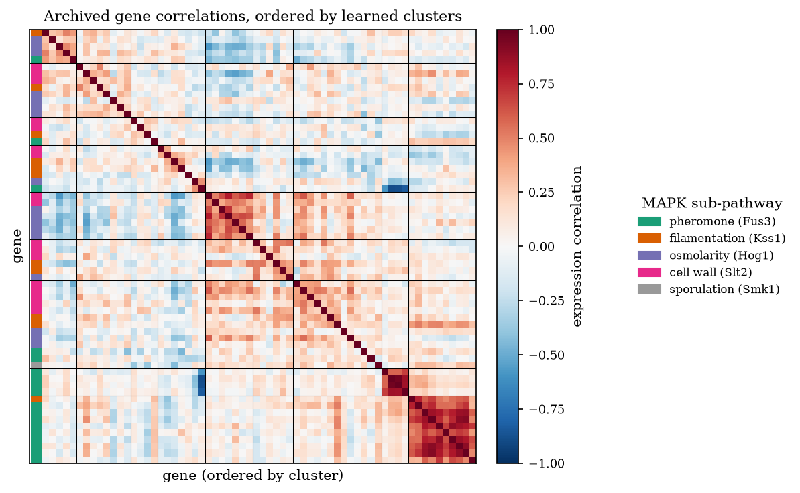
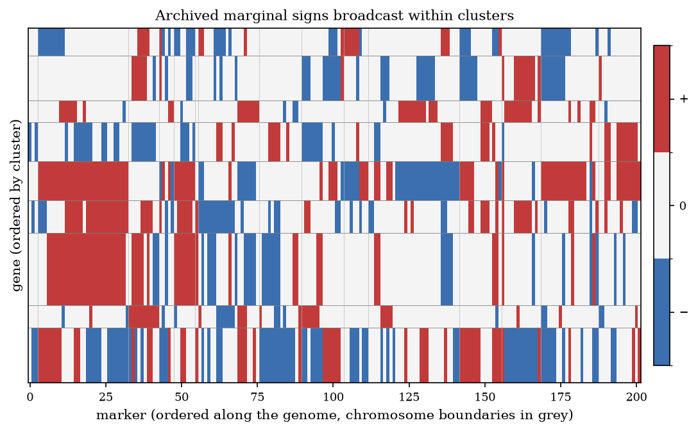
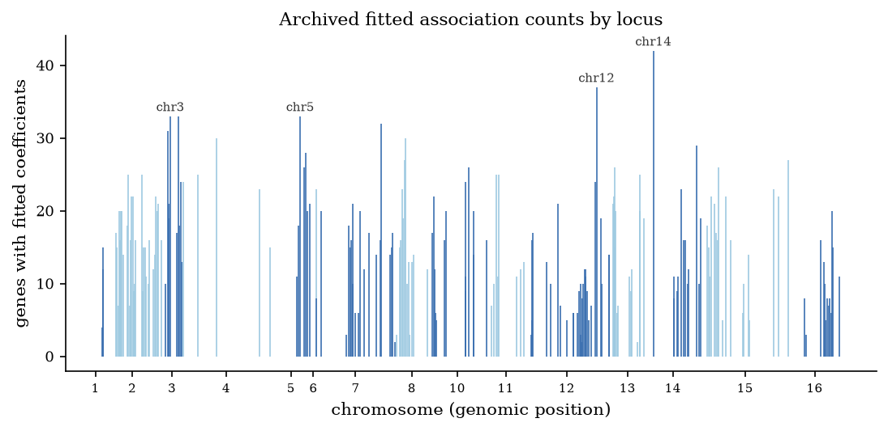

---
myst:
  html_meta:
    description: >-
      Yeast eQTL case study with nested training-only screening, clustering and tuning:
      pooled sign exclusion lowers prediction scores, selection overlap is low, and
      historical association plots do not establish biological discovery.
---

# Sign pooling beyond finance: yeast eQTL

*Author: [Artur Sepp](https://github.com/ArturSepp) / First recorded: [2026-09-26](https://github.com/ArturSepp/factorlasso/commit/26290d6bb9f527a0276eb4caa231211ce07819a9)*

Implemented in [factorlasso](https://github.com/ArturSepp/factorlasso).
Software citation: [CITATION.cff](https://github.com/ArturSepp/factorlasso/blob/main/CITATION.cff).

In an expression quantitative trait locus (eQTL) study, gene-expression responses share a panel
of genetic-marker predictors. Correlated responses offer a possible pooling opportunity, but
their conditional coefficient signs are unknown. This page reports the revised sign-pooling
manuscript's "Application to yeast eQTL data" (Sepp and Kastenholz, 2026a). It distinguishes the
current nested evaluation from the archived full-sample descriptions.

## Overview

The study fits 64 yeast MAPK genes using markers from 112 segregants. The corrected evaluation
repeats screening, scaling, clustering, sign estimation and penalty selection within training
data. Hard pooled exclusion reduces median-gene prediction scores relative to matched
unconstrained and singleton-gated fits. Releasing failed gates performs similarly to
unconstrained HCGL, without establishing equivalence. High direction agreement among cells
selected twice accompanies low selection overlap; it is not validation of biological signs.

## Study design and data

- **Data.** Expression and genotypes of $T=112$ segregants from the yeast cross of Brem and
  Kruglyak (2005), with 3244 candidate markers in the committed replication inputs.
- **Responses.** $N=64$ genes selected using the prespecified KEGG MAPK pathway annotation,
  rather than the canonical 54-gene subset in Yin and Li (2011).
- **Nested evaluation.** Three repeats of three outer folds, each with three inner folds
  (seed 20261024). Every training fold independently performs linkage-disequilibrium thinning
  at absolute correlation 0.92, marginal screening at $p\leq0.01$ in at least two genes,
  centering, scaling, Ward clustering and sign derivation. The screening threshold is not a
  significance guarantee for the final conditional coefficients.
- **Training partitions.** Outer training sets retain 136 to 194 markers and form three or
  four response clusters. The Ward distance is Euclidean distance between standardized
  response vectors divided by the square root of the training size. The cut is 0.7 of the
  final merge height. This is the paper's specified geometry, supplied explicitly to the
  package; the package's default clustering convention is unchanged.
- **Weighting.** All segregants receive equal weight. The revised evaluation uses the
  date-score gate; "date" means an observation row here. It allows responses from the same
  segregant to be dependent while assuming independent segregants.

## Configuration

The baseline fixes gate threshold $\tau=2$, cut fraction 0.7, HCGL/FCGL mixing parameter 0.5,
zero prior target and nonadaptive weights. Each method tunes its own penalty on the fractions
1, 0.3, 0.1 and 0.03 of its training-only zero-solution Karush--Kuhn--Tucker (KKT) scale. All baseline outer fits
select the interior fraction 0.3; their numerical penalties are not necessarily equal.
Ten prespecified neighboring configurations assess sensitivity separately, without selecting
settings from outer outcomes.

The canonical offline example illustrates the HCGL fitting stage on synthetic data:

```python
CONFIGURATION = {
    "model_type": fl.LassoModelType.HIERARCHICAL_CLUSTER_GROUP_LASSO,
    "reg_lambda": 0.1,  # Illustrative fixed penalty; the empirical study tunes it in inner folds.
    "l1_weight": 0.5,
    "auto_sign_constraints": True,
    "auto_sign_threshold_t": 2.0,
    "auto_sign_variance": "date",
    "demean": True,
    "solver": "CLARABEL",
}
```

It derives a training-only Ward partition with the paper's cut convention and supplies it via
`fit(..., external_clusters=clusters)`. It is a mechanism check, not the empirical pipeline or
a reproduction of the paper's scores. The empirical fits use MOSEK and nested penalty tuning;
the teaching example uses CLARABEL with a fixed illustrative penalty. Package defaults remain
unchanged, including `auto_sign_variance="independent"` and automatic signs being disabled.

## Results

### Current nested prediction

The following values are quoted from the manuscript's "Repeated nested validation" table.
They are means over three repeats; parentheses give standard deviations across splits of the
same segregants, not sampling standard errors or confidence intervals. For each repeat,
out-of-fold predictions are pooled before calculating per-gene scores relative to training-fold
means. Pooled $R^2$ sums squared errors across genes before taking the ratio, giving more weight
to genes with greater baseline variation in their original expression units.

| Method | Median gene $R^2$ | Pooled $R^2$ |
|---|---|---|
| Unconstrained Lasso | 0.051 (0.004) | 0.534 (0.007) |
| Singleton-gated Lasso, exclude | 0.051 (0.004) | 0.534 (0.007) |
| HCGL, unconstrained | 0.073 (0.006) | 0.488 (0.016) |
| HCGL, singleton/exclude | 0.065 (0.012) | 0.486 (0.015) |
| HCGL, pooled/exclude | 0.035 (0.010) | 0.398 (0.047) |
| HCGL, pooled/release | 0.073 (0.005) | 0.473 (0.038) |
| FCGL, unconstrained | 0.056 (0.009) | 0.498 (0.006) |
| FCGL, pooled/exclude | 0.036 (0.002) | 0.419 (0.043) |

Pooled-minus-singleton HCGL exclusion has paired median-gene difference $-0.0307$ (split SD
0.0045); FCGL exclusion minus unconstrained FCGL gives $-0.0195$ (split SD 0.0068). Both are
negative in every repeat. The median-gene and pooled scores give different rankings for Lasso
and unconstrained HCGL, so there is no uniform winning method. Across the ten sensitivity
settings, pooled exclusion remains worse than unconstrained and released-gate HCGL in every
repeat. This is a finite study on one cross, not an exhaustive tuning comparison.

### Current partition and selection stability

Across the 36 pairs of nine overlapping outer-training fits, mean cluster adjusted Rand index
is 0.420 and retained-marker Jaccard overlap is 0.253. Overall fitted-cell Jaccard overlap is
0.136 for unconstrained HCGL, 0.152 for singleton exclusion, 0.119 for pooled exclusion and 0.134
for pooled release. Direction agreement conditional on selection in both fits is 0.998 to 1.000
for these methods. Thus agreement on the relatively few shared selected cells does not mean
stable selection across the full gene-marker panel.

Selection uses magnitude greater than $10^{-6}$ in training-standardized units. Raising the
tolerance to $10^{-4}$ changes any method's mean Jaccard by at most 0.0025. An absent marker
after preprocessing is distinguished from a retained marker fitted to zero. Overlapping
splits, marker substitution under residual linkage disequilibrium and differing selection
sizes limit interpretation. These numbers measure resampling stability, not recovery of
unknown biological support (manuscript, "Partition and fitted-coefficient stability").

### Historical descriptive exhibits

The following figures preserve the original full-sample fit with 202 screened markers, nine
groups, the independent-cell gate and the legacy cut. They are not figures from the current
nested evaluation. The revised supplement's "Superseded eQTL analysis" explains the correction.



*Archived descriptive exhibit. Correlations and annotation labels for the same 112 segregants
used to discover the nine groups. This visual comparison does not validate pathway recovery.*



*Archived descriptive exhibit. Negative, zero and positive broadcast signs on the full sample.
Block coherence is partly imposed by pooling; zero entries exclude coefficients rather than
leave their signs unrestricted. Same-sample marginal agreement is not biological validation.*



*Archived descriptive exhibit. Fitted association counts along the genome. Peaks are candidate
hubs without independent biological validation; this plot does not establish recovered eQTL
hotspots.*

The old prediction comparison screened outcomes before splitting, called a gated per-response
fit ordinary Lasso, and used a common numerical penalty across differently scaled objectives.
Its prediction rankings are superseded and are not performance evidence. Retaining these
descriptive figures does not repair or endorse that old validation protocol.

## What the study does and does not show

- **Hard pooled exclusion can harm prediction.** The matched comparisons separate the effects
  of pooling and restrictions from the row or coupled penalty; the loss persists across the
  prespecified sensitivity settings.
- **Marginal coherence is not conditional truth.** Held-out marginal coherence exceeds a
  size-matched random-partition reference, but neither that comparison nor the historical plots
  establishes correct conditional directions, pathways or biological discoveries.
- **Selection is unstable even when shared signs agree.** Direction agreement must be reported
  with its shared-selection denominator and selection overlap.
- **These are resamples of one yeast cross.** They are not independent biological replications.
  The study does not establish a general benefit of pooling or validate adaptive/prior-target
  extensions.

## Reproduce

The self-contained synthetic example targets factorlasso 1.0.5 or later and uses NumPy, pandas
and SciPy. It checks every
date-score slope and statistic against direct residual-score calculations and verifies the
fitted hard constraints. It needs no data file or network access and does not recompute the
empirical table:

```python
def training_partition(y: pd.DataFrame) -> pd.Series:
    """Ward groups from standardized training responses, cut at 0.7 of final merge."""
    distances = pdist(y.to_numpy().T) / np.sqrt(len(y))
    tree = linkage(distances, method="ward")
    labels = fcluster(tree, CUT * tree[-1, 2], criterion="distance")
    return pd.Series(labels, index=y.columns, name="cluster")
```

Run [the canonical script](../examples/docs/app_sign_pooling_genomics.py) from a checkout:

```console
python examples/docs/app_sign_pooling_genomics.py
```

For the complete corrected empirical analysis, follow the
[paper replication README](https://github.com/ArturSepp/factorlasso/blob/main/papers/sign_pooling_2026/README.md), using
[`eqtl_validation.py`](../papers/sign_pooling_2026/replication/eqtl_validation.py),
[`eqtl_sensitivity.py`](../papers/sign_pooling_2026/replication/eqtl_sensitivity.py) and
[`eqtl_stability.py`](../papers/sign_pooling_2026/replication/eqtl_stability.py). The baseline
command defaults to six methods; the documented expanded comparison adds the matched
singleton-HCGL and unconstrained-FCGL controls. Outputs belong in a fresh external directory.
Full archived fits require a MOSEK license. The older `eqtl_pipeline.py` retains only the
superseded descriptive reproduction and must not be used for the corrected prediction table.

## See also

- [Gated cluster-pooled sign derivation](gated_cluster_pooled_signs.md): screening and variance
  conventions.
- [Cluster discovery](cluster_discovery.md): clustering inputs and package conventions.
- [Research papers and replication](scientific-replication.md): the paper and replication tree.

## References

- Brem, R. B., and Kruglyak, L. (2005). The landscape of genetic complexity across 5,700 gene
  expression traits in yeast. *Proceedings of the National Academy of Sciences* 102(5),
  1572-1577. DOI 10.1073/pnas.0408709102.
- Hubert, L., and Arabie, P. (1985). Comparing partitions. *Journal of Classification* 2(1),
  193-218. DOI 10.1007/BF01908075.
- Sepp, A., and Kastenholz, M. A. (2026a). Gated Cluster-Pooled Sign Constraints for Multi-Output
  Sparse Regression. Revised working manuscript; prepared for *Computational Statistics*.
  [Manuscript](../papers/sign_pooling_2026/paper/article.pdf) and
  [supplement](../papers/sign_pooling_2026/paper/supplement.pdf).
- Yin, J., and Li, H. (2011). A sparse conditional Gaussian graphical model for analysis of
  genetical genomics data. *The Annals of Applied Statistics* 5(4), 2630-2650.
  DOI 10.1214/11-AOAS494.
- [factorlasso software citation](https://github.com/ArturSepp/factorlasso/blob/main/CITATION.cff).
