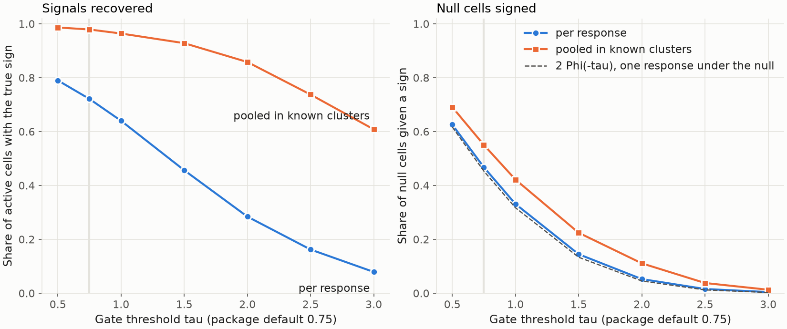
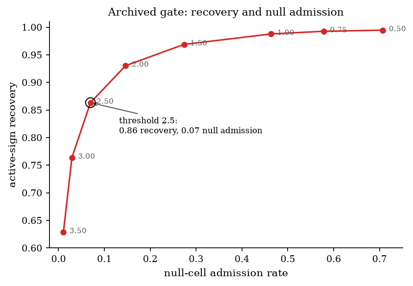
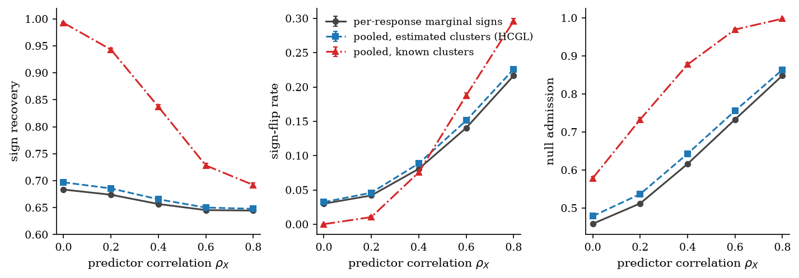

---
myst:
  html_meta:
    description: >-
      Gated cluster-pooled sign derivation in factorlasso: pooled univariate slopes within
      response clusters, a closed-form noise-floor gate, hard sign constraints from the surviving
      signs, the weighted date-score variant, and a simulation of recovery and false signs.
---

# Gated cluster-pooled sign derivation

*Author: [Artur Sepp](https://github.com/ArturSepp) / First recorded: [2026-09-26](https://github.com/ArturSepp/factorlasso/commit/26290d6bb9f527a0276eb4caa231211ce07819a9)*

Implemented in [factorlasso](https://github.com/ArturSepp/factorlasso).
Software citation: [CITATION.cff](https://github.com/ArturSepp/factorlasso/blob/main/CITATION.cff).

Gated cluster-pooled sign derivation estimates the sign matrix of a factor model from the data.
For each cluster of similar responses and each factor it computes one pooled univariate slope,
keeps the slope's sign only when its t-statistic clears a noise floor, and passes the surviving
signs to the estimator as hard constraints. Pooling can improve precision when responses share
an exposure direction, but correlated residuals limit the gain. A failed gate fixes the loading
at zero; it does not leave the loading unrestricted.

## Overview

The [sign constraints](sign_constraints_and_priors.md) article describes what a sign matrix does
once it is given. Often it is not given: an analyst knows that funds of one style share their
exposures, but not the sign of every loading. The univariate slope of a response on one factor
carries a marginal association sign, which need not equal a conditional multivariate loading's
sign. Hard constraints built from marginal signs are related to univariate-guided sparse
regression (Chatterjee, Hastie and Tibshirani, 2025; Richland et al., 2025, equation 3.3). With a
short history, however, a single response's slope is noisy and its sign often wrong or
uninformative.

factorlasso pools. Responses in one cluster, such as the HCGL clusters discovered from the
response correlations, are assumed to share the direction of their exposures, so their slopes
are estimated jointly. A closed-form gate then decides, cluster by cluster and factor by factor,
whether to retain its sign. Sepp and Kastenholz (2026a) give sufficient conditions for correct
gate directions on nonzero coefficients in fixed dimensions, together with fitted-estimator
experiments. That result does not establish coefficient-support recovery, an oracle
distribution, or the consistency of jointly tuned clustering and thresholds. This article
describes the implementation and illustrates its screening trade-off on a small panel.

Two parts of uniLasso are not inherited. Its second stage fits a non-negative LASSO on
leave-one-out predictions, whereas here the signs constrain the coefficients of the original
factors directly. And uniLasso has no hard noise floor: the gate is closer to screening by
marginal evidence before regularisation (Fan and Lv, 2008).

## Inputs, notation, and assumptions

| Symbol or input | Meaning | Units and convention |
|---|---|---|
| $x_j$ | Column of factor $j$ over $T$ dates, demeaned as the solver sees it | Decimal returns per period |
| $y_k$ | Column of response $k$ | Decimal returns per period |
| $\mathcal{C}$, $m$ | A cluster of responses and its size | Supplied groups or discovered clusters |
| $\hat\beta_{j,\mathcal{C}}$ | Pooled univariate slope of cluster $\mathcal{C}$ on factor $j$ | Dimensionless |
| $t_{j,\mathcal{C}}$ | Its t-statistic | Dimensionless |
| $\tau$ | Gate threshold, `auto_sign_threshold_t` | Default 0.75; `None` disables thresholding but retains slope signs; positive infinity fails every automatic gate |
| $s_{kj}$ | Derived sign of response $k$ on factor $j$ | $1$, $-1$ or $0$ |

The derivation runs inside `fit` on the demeaned, masked arrays that the solver receives, so
under cross-validation it is repeated on each training fold and sees no held-out data. Missing
cells are excluded from every sum. The other conventions are those of the
[conventions page](conventions.md).

## Methodology

### Pooled slope

For a cluster $\mathcal{C}$ of $m$ responses, the pooled slope on factor $j$ is the slope of the
summed responses, divided by the cluster size,

$$
\hat\beta_{j,\mathcal{C}} = \frac{x_j^{\top} y_{\mathcal{C}}}{m x_j^{\top} x_j},
\qquad y_{\mathcal{C}} = \sum_{k \in \mathcal{C}} y_k ,
$$

which is the least-squares slope of all $mT$ response observations of the cluster on the
repeated factor column. Every member of the cluster receives the same slope, so the derived
signs are coherent within the cluster by construction.

### The noise-floor gate

For the default `"independent"` variance with equal weights and no missing data, the residual sum
of squares of the pooled regression is
$\mathrm{SSR}_j = \sum_{k \in \mathcal{C}} y_k^{\top} y_k - m \hat\beta_{j,\mathcal{C}}^2 x_j^{\top} x_j$,
and the t-statistic is

$$
t_{j,\mathcal{C}} = \hat\beta_{j,\mathcal{C}} \left( \frac{\mathrm{SSR}_j}{(mT - m) m x_j^{\top} x_j} \right)^{-1/2}.
$$

At a finite positive threshold, the derived sign of response $k$ in cluster $\mathcal{C}(k)$ is

$$
s_{kj} = \mathrm{sign}(\hat\beta_{j,\mathcal{C}(k)}) \quad \text{if } \lvert t_{j,\mathcal{C}(k)} \rvert \ge \tau,
\qquad s_{kj} = 0 \quad \text{otherwise}.
$$

A zero is a hard constraint too: the loading is fixed at zero, which excludes a factor without
sufficient marginal evidence from the regression. A failed gate can therefore delete a truly
active coefficient. It is not the release convention, which would leave that cell unrestricted.

`auto_sign_threshold_t=None` retains each slope's sign; it does not disable sign constraints.
An exactly zero slope still gives a zero sign. Positive infinity explicitly fails every
automatic gate, including an exactly noiseless nonzero slope whose statistic is itself infinite.
The slopes and diagnostics remain available, and explicit constraints, prior signs and excluded
factors retain their usual precedence. This endpoint repair applies to the current development
source; older releases could retain noiseless signs at an infinite threshold.

The statistic is a screening score, not a calibrated significance test. A larger threshold
changes the balance between retained signs and exclusions, but no universal threshold controls
false signs, family-wise error or false discovery rate. In particular, a null conditional
coefficient can have a nonzero marginal slope when predictors are correlated. Choose and assess
the threshold within training data and report both prediction and selection stability.

### Which responses are pooled

The pooling unit follows the model type:

| `model_type` | Pooling |
|---|---|
| `LASSO` | None: each response derives its own signs. |
| `GROUP_LASSO` | Within each group of `group_data`. |
| `HIERARCHICAL_CLUSTER_GROUP_LASSO`, `FACTOR_CLUSTER_GROUP_LASSO` | Within each cluster discovered from the response correlations, the same clusters the penalty uses. |
| `UNILASSO`, `COOPERATIVE_GROUP_LASSO`, `COOPERATIVE_CLUSTER_GROUP_LASSO` | Not enforced: these solvers take no sign constraint. |

### Weights, missing data and dependent responses

The general form weights date $t$ by $w_t$, an EWMA weight on the original row grid, and masks
missing cells with $v_{tk}$:

$$
\hat b_j = \frac{\sum_t \sum_{k \in \mathcal{C}} w_t v_{tk} x_{tj} y_{tk}}{\sum_t \sum_{k \in \mathcal{C}} w_t v_{tk} x_{tj}^2} .
$$

`auto_sign_variance="independent"`, the default, treats the response cells of a pool as
independent observations, as in the formula above. `auto_sign_variance="date"` sums the scores
of each date before squaring,

$$
u_{tj} = w_t x_{tj} \sum_{k \in \mathcal{C}} v_{tk} (y_{tk} - \hat b_j x_{tj}),
\qquad
\hat V_j = \frac{n_{\mathrm{eff}}}{n_{\mathrm{eff}} - 1} \frac{\sum_t u_{tj}^2}{\left(\sum_t \sum_{k} w_t v_{tk} x_{tj}^2\right)^2},
$$

a one-way cluster-robust sandwich over dates (Cameron and Miller, 2015) with the effective number
of dates $n_{\mathrm{eff}}$ in the correction. It allows the responses of a date to be correlated,
so duplicating every response leaves the statistic unchanged. It assumes independence across
dates (Sepp and Kastenholz, 2026a, "Response dependence in the gate"). Prefer explicit
`auto_sign_variance="date"` when pooled responses can be correlated; the public default remains
`"independent"` for compatibility. The weights come from
`auto_sign_ewma_span`, or from the fit's own span with `auto_sign_use_fit_span=True`; the default
weights dates equally. The effective-date correction is a weighting convention, not an exact
Student distribution. Neither variance option provides HAC inference for serial dependence.
With a fixed EWMA span, effective sample size remains bounded as older observations accumulate.

### Order of precedence

Derived signs are the lowest layer: explicit entries of `factors_beta_loading_signs` override
them, factors in `auto_sign_excluded_factors` are left free, and a finite non-zero prior centre
replaces a conflicting derived sign. The [conventions page](conventions.md#precedence-of-signs-and-priors)
draws the full order.

## Worked example

The canonical script
[`examples/docs/gated_cluster_pooled_signs.py`](../examples/docs/gated_cluster_pooled_signs.py)
follows the simulation design of Sepp and Kastenholz (2026a) at a smaller size: 24 responses in
four clusters of six, eight independent standard-normal predictors, three active predictors per
cluster with signs shared inside the cluster and magnitudes drawn from $[0.5, 1.5]$, 60 dates,
and a population $R^2$ of 0.10 per response. It first reproduces the pooled slope and gate of one
cluster by hand:

```python
members = list(clusters.index[clusters == 0])
y_cluster = y[members].to_numpy()
xx = np.sum(x.to_numpy() ** 2, axis=0)
size = len(members)
slope = x.to_numpy().T @ y_cluster.sum(axis=1) / (size * xx)
ssr = np.sum(y_cluster ** 2) - size * slope ** 2 * xx
se = np.sqrt(ssr / (size * N_OBS - size) / (size * xx))
t_stat = slope / se
```

The same derivation runs inside the estimator when groups are supplied; the script checks that
`derived_signs_` and `sign_t_stats_` equal the standalone calculation:

```python
model = fl.LassoModel(
    model_type=fl.LassoModelType.GROUP_LASSO,
    group_data=clusters,
    reg_lambda=1e-3,
    auto_sign_constraints=True,
    auto_sign_threshold_t=0.75,
).fit(x=x, y=y)
```

Over 100 redrawn panels, per-response and pooled derivations are compared for thresholds from 0.5
to 3:

```python
def derive_signs(x: pd.DataFrame, y: pd.DataFrame, clusters: pd.Series, tau: float,
                 pooled: bool) -> np.ndarray:
    """Gated sign matrix, per response or pooled within each known cluster."""
    x_np, y_np, labels = x.to_numpy(), y.to_numpy(), clusters.to_numpy()
    groups = ([[k] for k in range(y_np.shape[1])] if not pooled
              else [list(np.flatnonzero(labels == g)) for g in np.unique(labels)])
    signs = np.empty((y_np.shape[1], x_np.shape[1]))
    for members in groups:
        signs[members] = fl.derive_sign_constraints(x_np, y_np[:, members],
                                                    auto_sign_threshold_t=tau)
    return signs
```

At the default $\tau = 0.75$, per-response derivation recovers the true sign in 0.72 of the active
cells and excludes 0.26; pooling in the known clusters recovers 0.98 and excludes 0.02. The
gain comes from fewer exclusions, not from fewer wrong signs: neither derivation flips more than a few
per cent of active cells. Pooling pays on the null cells, signing 0.55 of them against 0.47 per
response. At $\tau = 2.5$ pooling still recovers 0.74
of the true signs while signing only 0.04 of the null cells.



*Synthetic teaching exhibit. Means over 100 panels of 24 responses in four clusters, eight
predictors, 60 dates and a population $R^2$ of 0.10. The light vertical line marks the package
default $\tau = 0.75$. Produced by `tools/docs_analytics/estimation.py` from the example script.*

The following archived experiment uses 60 responses in six known clusters, 20 predictors and
80 dates, with the historical independent-cell variance. Known clusters are an oracle diagnostic.
The revised manuscript retains this experiment under "Historical experiments and their
corrections" in Online Resource 1; it does not use it to justify a reporting threshold or a
general prediction claim. Current fitted-estimator and learned-cluster comparisons are in the
manuscript's "Simulation study".



*Archived paper exhibit. Historical base configuration, known-cluster pooling, independent-cell
variance, $\tau$ from 0.5 to 3.5, means over 200 replications. Preserved for reproduction; this is
not the revised manuscript's date-score gate validation.*

## Implementation in factorlasso

Implementation and canonical example verified with factorlasso 1.0.0 on 2026-10-03.

| Name | Role |
|---|---|
| `auto_sign_constraints` | Derive signs inside `fit`, pooled as in the table above. Default `False`. |
| `auto_sign_threshold_t` | The gate $\tau$; `None` keeps every slope's sign, and positive infinity sets every automatic sign to zero before overrides. |
| `auto_sign_variance` | `"independent"` (default) or `"date"`, the date-score sandwich. |
| `auto_sign_ewma_span`, `auto_sign_use_fit_span` | Weights of the sign statistics: a separate span, or the fit's own span. The default weights dates equally. |
| `auto_sign_excluded_factors` | Factors exempt from derived signs and from the zero gate. |
| `derived_signs_` | The final sign matrix the solver used, after explicit signs and prior centres. |
| `detected_signs_`, `sign_slopes_`, `sign_t_stats_`, `sign_effective_n_`, `sign_valid_counts_` | The detection layer before overrides: signs, pooled slopes, statistics, effective dates and observation counts. |
| `derive_sign_constraints` | The standalone derivation for one pool of responses: the columns of `y` passed are pooled. Its `clusters` argument groups factors, not responses, and `master_constraints` overrides single factors. |
| `validate_cluster_signs` | For a grouping of factors, lists the factors whose own marginal sign disagrees with the sign of their group's average, a hint that the group mixes opposite exposures. |

`derive_sign_constraints` returns a response-by-factor frame for pandas input, ready for
`factors_beta_loading_signs`, and the pooled slopes with `return_slopes=True`. Signs from
`LASSO` mode differ by response; from the group modes they are equal within each cluster before
explicit signs and prior centres are applied. To run the example from a checkout:

```console
python examples/docs/gated_cluster_pooled_signs.py
```

## Interpretation and limitations

- **A screening rule, not a test.** The gate supplies no calibrated false-sign or multiplicity
  guarantee. Higher thresholds remove more cells, including genuinely active ones; the default
  and the teaching example's threshold sweep are not significance levels.
- **Pooling assumes coherent clusters.** A cluster that mixes opposite exposures pools them into
  one slope, and minority members can receive the wrong sign. Correlation-based HCGL clustering
  does not itself establish common conditional coefficient signs.
- **Discovered clusters need signal.** The revised paper studies learned groups with both
  coherent and misspecified sign structures. Gains depend on recoverable groups, factor
  dependence and the cut; known groups cannot substitute for this evaluation.
- **Correlated predictors break the marginal sign.** A marginal slope absorbs correlated
  factors, so its sign can differ from the conditional loading, and as the predictor correlation
  rises the derived signs can flip (archived figure below). A wrong hard sign excludes the true
  nonzero loading: the fitted value can be zero or nonzero with the wrong sign. The penalty does
  not guarantee abstention. Compare unrestricted, exclusion and release fits on held-out data.
- **The `"independent"` variance omits response covariance.** Positive residual dependence can
  inflate its evidence; changing to `"date"` need not reduce every statistic or improve every
  estimate. The two choices keep pooled slopes unchanged but can alter gates and fitted
  coefficients. The familiar design effect $1+(m-1)\bar\rho$ describes a homogeneous special
  case, not every pool with unequal effects or missing observations.



*Archived paper exhibit. Historical base configuration with correlated predictors,
$\rho_X$ from 0 to 0.8, per-response, estimated-cluster (HCGL) and known-cluster derivations
using the independent-cell gate. These are gate diagnostics, not fitted-estimator errors.*

## See also

- [Sign constraints and prior-centred penalties](sign_constraints_and_priors.md): what the derived
  signs do in the estimator.
- [Prior targets](prior_targets.md): a centre's sign can replace a derived sign.
- [Group penalties: HCGL, sparse-group and FCGL](group_penalties_hcgl_fcgl.md): the clusters the
  pooling uses.
- [EWMA weighting and ragged histories](ewma_weighting_and_ragged_histories.md): the weights and
  masks of the sign statistics.
- [Credit attribution case study](app_multi_asset_credit_attribution.md): the gate at
  $\tau = 1.0$ in the JSS study, with its $\tau$ sweep.

## References

- Cameron, A. C., and Miller, D. L. (2015). A practitioner's guide to cluster-robust inference.
  *Journal of Human Resources* 50(2), 317-372. DOI 10.3368/jhr.50.2.317.
- Chatterjee, S., Hastie, T., and Tibshirani, R. (2025). Univariate-guided sparse regression.
  *Harvard Data Science Review* 7(3). DOI 10.1162/99608f92.c79ff6db.
- Chiquet, J., Grandvalet, Y., and Charbonnier, C. (2012). Sparsity with sign-coherent groups of
  variables via the cooperative-Lasso. *The Annals of Applied Statistics* 6(2), 795-830.
  DOI 10.1214/11-AOAS520.
- Fan, J., and Lv, J. (2008). Sure independence screening for ultrahigh dimensional feature
  space. *Journal of the Royal Statistical Society: Series B* 70(5), 849-911.
- Richland, J., Kiiskinen, T., Wang, W., Lu, S., Narasimhan, B., Hastie, T., Rivas, M., and
  Tibshirani, R. (2025). Univariate-guided sparse regression for biobank-scale high-dimensional
  omics data. arXiv:2511.22049.
- Sepp, A., and Kastenholz, M. A. (2026a). Gated Cluster-Pooled Sign Constraints for Multi-Output
  Sparse Regression. Revised working manuscript; prepared for *Computational Statistics*.
  [Manuscript](../papers/sign_pooling_2026/paper/article.pdf).
- Sepp, A., and Kastenholz, M. A. (2026b). factorlasso: Sparse Multi-Output Regression with
  Cluster-Grouped Sign Constraints in Python. Submitted to the *Journal of Statistical
  Software*. Manuscript retained locally; not distributed in this checkout.
- [factorlasso software citation](https://github.com/ArturSepp/factorlasso/blob/main/CITATION.cff).
